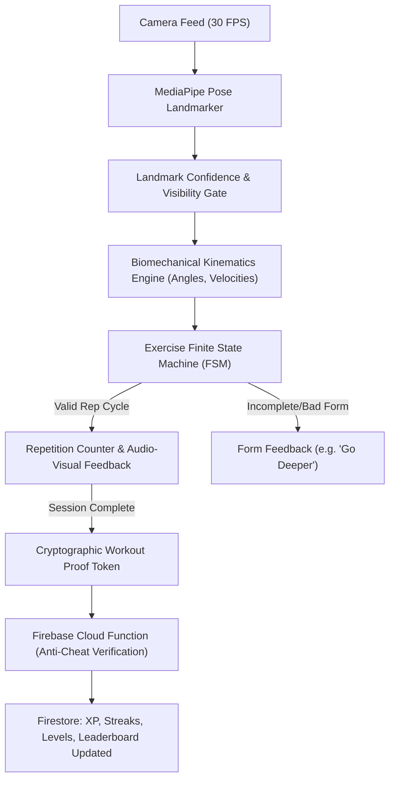
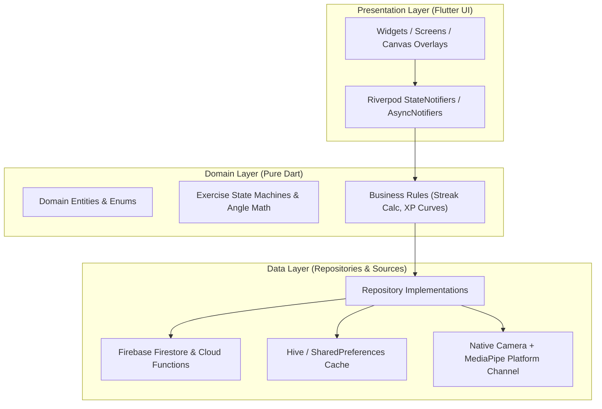
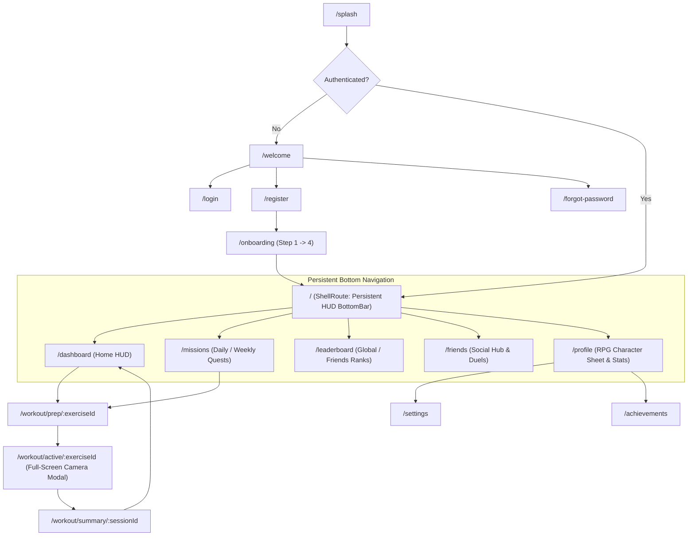
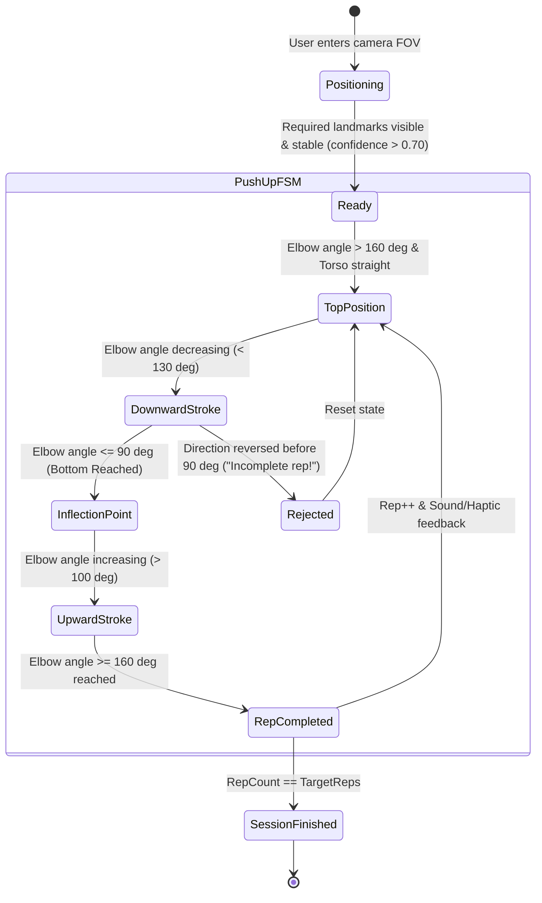

# LEVEL UP — Complete Technical Architecture & System Blueprint

> **Tagline:** TRAIN. COMPLETE. LEVEL UP.  
> **Target OS:** Android (Flutter 3.x + MediaPipe On-Device Vision)  
> **Backend:** Firebase (Authentication, Cloud Firestore, Cloud Functions, Cloud Messaging)  
> **Version:** 1.0.0-Blueprint  

---

## 1. Executive Summary & Product Vision

**LEVEL UP** bridges physical exercise and mobile RPG gamification. Rather than passively recording user workouts, LEVEL UP acts as an active **AI Coach and Referee**:
- **Computer Vision Verification:** Uses real-time on-device human pose detection (33 MediaPipe body landmarks) to ensure repetitions are physically performed with full range of motion.
- **RPG Progression:** Awards XP, levels, rank titles (from *Rookie* to *Mythic*), streaks, and achievement badges for verified physical output.
- **Social Gamification:** Asynchronous workout duels, friend leaderboards, and co-op daily missions.



---

## 2. System Architecture & Clean Modular Design

The application follows **Clean Modular Architecture** combined with **Riverpod (2.x)** for declarative state management, separating concerns into four discrete layers:



### Directory Structure

```
level_up/
├── lib/
│   ├── main.dart                          # App initialization, Firebase init, Riverpod Scope
│   ├── app.dart                           # MaterialApp with theme, router, global listeners
│   ├── core/
│   │   ├── theme/                         # Neon dark theme, palette, gradients, typography
│   │   ├── constants/                     # Asset paths, animation durations, XP constants
│   │   ├── routing/                       # GoRouter configuration, redirects, shell routes
│   │   ├── services/                      # Sound player, haptics, local notifications
│   │   └── utils/                         # Angle math, smoothing filters, date formatters
│   ├── features/
│   │   ├── authentication/                # Login, Register, Google Auth, Forgot Password
│   │   ├── onboarding/                    # Multi-step fitness intake & goal setting
│   │   ├── dashboard/                     # Home screen, daily progress HUD, streak banner
│   │   ├── missions/                      # Daily, weekly, bonus mission list and cards
│   │   ├── workout/                       # Pre-workout prep, summary, manual & AI workouts
│   │   ├── ai_detection/                  # MediaPipe camera controller, pose painter, FSMs
│   │   ├── progression/                   # Level-up celebrations, XP calculations, ranks
│   │   ├── streaks/                       # Streak tracker, calendar heat-map, rest days
│   │   ├── achievements/                  # Badges, unlock conditions, showcase
│   │   ├── friends/                       # Social search, friend list, 1v1 challenge invites
│   │   ├── leaderboard/                   # Weekly, global, and friends ranking boards
│   │   ├── statistics/                    # fl_chart analytics, rep volumes, active days
│   │   └── profile/                       # User stats, avatar, settings, account deletion
│   └── shared/
│       ├── widgets/                       # NeonButton, GlassCard, LevelPill, StatChip
│       └── models/                        # Common response wrappers, result types
```

---

## 3. Screen Hierarchy & Navigation Architecture

Navigation uses **GoRouter** with a stateful shell route supporting persistent bottom navigation tabs and full-screen modal overlays for AI camera workouts.



---

## 4. Cloud Firestore Data Schema

### 4.1 Collection: `users/{userId}`
Stores player RPG identity, current attributes, and aggregated fitness statistics.

```json
{
  "uid": "usr_94821a8f",
  "username": "KageShadow",
  "displayName": "Hruthik",
  "photoUrl": "https://storage.googleapis.com/.../avatar.png",
  "level": 8,
  "currentXp": 1250,
  "xpToNextLevel": 1500,
  "rankTitle": "Warrior",
  "currentStreak": 12,
  "longestStreak": 15,
  "lastActiveDate": "2026-11-12T00:00:00Z",
  "restDaysUsedThisWeek": 1,
  "fitnessProfile": {
    "experience": "intermediate",
    "primaryGoal": "strength_endurance",
    "weeklyTargetDays": 5,
    "preferredDifficulty": "heroic"
  },
  "stats": {
    "totalWorkouts": 45,
    "totalValidReps": 1420,
    "totalDurationSeconds": 18240,
    "perfectFormPercentage": 88.5
  },
  "createdAt": "2026-09-01T12:00:00Z",
  "updatedAt": "2026-11-12T19:45:00Z"
}
```

### 4.2 Collection: `daily_missions/{userId}/dates/{yyyy-MM-dd}`
Contains the daily exercise assignment generated based on player tier.

```json
{
  "date": "2026-11-12",
  "allCompleted": false,
  "dailyBonusXp": 50,
  "dailyBonusClaimed": false,
  "missions": [
    {
      "id": "pushup_01",
      "exerciseType": "push_up",
      "targetReps": 15,
      "completedReps": 15,
      "xpReward": 20,
      "status": "completed",
      "verifiedByAi": true
    },
    {
      "id": "squat_01",
      "exerciseType": "squat",
      "targetReps": 25,
      "completedReps": 25,
      "xpReward": 20,
      "status": "completed",
      "verifiedByAi": true
    },
    {
      "id": "situp_01",
      "exerciseType": "sit_up",
      "targetReps": 20,
      "completedReps": 0,
      "xpReward": 20,
      "status": "pending",
      "verifiedByAi": false
    },
    {
      "id": "plank_01",
      "exerciseType": "plank",
      "targetSeconds": 30,
      "completedSeconds": 0,
      "xpReward": 15,
      "status": "pending",
      "verifiedByAi": false
    },
    {
      "id": "jumpingjack_01",
      "exerciseType": "jumping_jack",
      "targetReps": 30,
      "completedReps": 0,
      "xpReward": 15,
      "status": "pending",
      "verifiedByAi": false
    }
  ]
}
```

### 4.3 Collection: `workout_sessions/{sessionId}`
Immutable historical logs of verified workouts.

```json
{
  "sessionId": "ses_7741029",
  "userId": "usr_94821a8f",
  "exerciseType": "push_up",
  "targetReps": 15,
  "completedReps": 15,
  "validReps": 15,
  "rejectedReps": 2,
  "durationSeconds": 68,
  "averageRepDurationMs": 3200,
  "verificationStatus": "verified",
  "xpEarned": 20,
  "deviceTelemetry": {
    "fps": 28.4,
    "confidenceAvg": 0.92
  },
  "timestamp": "2026-11-12T19:40:12Z"
}
```

---

## 5. Gamification Mechanics & Mathematical Models

### 5.1 Level and XP Progression Formula

LEVEL UP uses a quadratic RPG progression formula to ensure satisfying early progress while preventing runaway inflation at high tiers:

$$\text{XP}_{\text{required}}(L) = 100 \times L^{1.35}$$

Where:
- Cumulative XP to reach Level $L$:
$$\text{XP}_{\text{total}}(L) = \sum_{k=1}^{L-1} \left\lfloor 100 \times k^{1.35} \right\rfloor$$

#### Progression Tiers

| Level Range | Rank Title | Theme Color | Unlock Perks |
| :--- | :--- | :--- | :--- |
| **1 – 4** | **Rookie** | Charcoal Gray (`#808080`) | Basic Mission Deck, Push-Up AI Tracker |
| **5 – 9** | **Beginner** | Cyan Glow (`#00E5FF`) | Squat & Sit-Up Tracking, Friend Challenges |
| **10 – 19** | **Warrior** | Neon Lime (`#00FF66`) | Custom Mission Modifiers, Plank Timer AI |
| **20 – 29** | **Champion** | Amber Gold (`#FFB800`) | Global Tournaments, Jumping Jack AI |
| **30 – 49** | **Elite** | Violet Blaze (`#A855F7`) | Custom Avatar Auras, Team Quests |
| **50 – 99** | **Legend** | Crimson Dragon (`#EF4444`) | Legendary Title Badge, Hall of Fame |
| **100+** | **Mythic** | Holographic Prismatic | Custom Animated Frame, Mythic Halo |

### 5.2 Streak Mechanics & Rest Day Algorithm

A streak is incremented if all required daily missions (or an approved Active Recovery workout) are finished within the user's localized 24-hour calendar day ($00:00 - 23:59$).

- **Streak Bonus:** Every 7-day milestone adds a $+10\%$ XP multiplier for the next 7 days:
$$\text{XP}_{\text{earned}} = \text{XP}_{\text{base}} \times \left(1 + \min\left(0.50, 0.10 \times \left\lfloor \frac{\text{Streak}}{7} \right\rfloor\right)\right)$$
- **Rest Days:** Users are granted **2 Rest Day Shields** per rolling 7 days. If the user marks a rest day, their streak is frozen rather than broken, preventing fatigue injuries.

---

## 6. AI Exercise Recognition & Computer Vision Engine



### 6.1 MediaPipe Landmark Map (33 Keypoints)

The engine consumes 3D normalized coordinates $(x, y, z, \text{visibility})$ from MediaPipe:
- **Push-ups:** Shoulder (11/12), Elbow (13/14), Wrist (15/16), Hip (23/24), Ankle (27/28).
- **Squats:** Hip (23/24), Knee (25/26), Ankle (27/28), Shoulder (11/12).
- **Sit-ups:** Shoulder (11/12), Hip (23/24), Knee (25/26).
- **Planks:** Shoulder (11/12), Hip (23/24), Knee (25/26), Ankle (27/28).
- **Jumping Jacks:** Wrist (15/16), Shoulder (11/12), Hip (23/24), Ankle (27/28).

### 6.2 3-Point Angle Calculation

Given three points $A(x_1, y_1)$, $B(x_2, y_2)$ (vertex), $C(x_3, y_3)$:

$$\vec{BA} = (x_1 - x_2, y_1 - y_2), \quad \vec{BC} = (x_3 - x_2, y_3 - y_2)$$

$$\theta = \arccos\left(\frac{\vec{BA} \cdot \vec{BC}}{\|\vec{BA}\| \|\vec{BC}\|}\right) \times \frac{180^\circ}{\pi}$$

### 6.3 Signal Smoothing & Noise Filtering
Raw landmark coordinates fluctuate due to lighting and motion blur. We apply an **Exponential Moving Average (EMA)** filter to joint angles:

$$\hat{\theta}_t = \alpha \cdot \theta_t + (1 - \alpha) \cdot \hat{\theta}_{t-1}, \quad \text{with } \alpha = 0.65$$

And an angular velocity check prevents instant teleportation anomalies:
$$|\hat{\theta}_t - \hat{\theta}_{t-1}| \le \Delta\theta_{\max}$$

---

## 7. Design System & Neon RPG UI Theme

| Element | Hex Code | Purpose |
| :--- | :--- | :--- |
| **Deep Black** | `#0A0A0C` | Primary app background (OLED energy saving & high contrast) |
| **Dark Charcoal** | `#16161A` | Card backgrounds, list item surfaces |
| **Elevated Surface** | `#222228` | Dialogs, bottom sheets, active HUD indicators |
| **Neon Lime** | `#00FF66` | Primary action buttons, verified reps, level indicators |
| **Emerald Accent** | `#059669` | Secondary badges, completed states |
| **Electric Cyan** | `#00E5FF` | AI tracking lines, pose skeleton highlights |
| **Warning Amber** | `#FFB800` | Form correction notices, streak flames |
| **Destructive Red** | `#EF4444` | Incomplete rep warnings, stop session button |
| **Text Primary** | `#FFFFFF` | High-emphasis headings, rep counts |
| **Text Secondary** | `#94A3B8` | Body text, targets, timestamps |

---

## 8. Anti-Cheat & Security Blueprint

To keep the game fair and competitive:
1. **No Direct XP Mutation:** The mobile client cannot directly edit the user's `xp` or `level` fields in Firestore.
2. **Session Verification Token:** When a workout completes, the client submits:
   - Total time elapsed
   - Per-rep timestamp array $[\Delta t_1, \Delta t_2, \dots]$
   - Min/max inflection angles
3. **Cloud Function Validation:**
   - Rejects push-up sessions where reps took $< 800\text{ ms}$ (physiologically impossible human cadence).
   - Verifies daily mission ID was not already completed today.
   - Computes streak update atomically via Firestore transaction.

---

## 9. 7-Phase Execution Plan

1. **Milestone 1 (UI & Foundation):** Complete design system, Splash, Onboarding, Auth UI, Dashboard, Missions list, Workout detail, Profile, Bottom Nav with realistic mock data.
2. **Milestone 2 (Firebase Auth & User Profile):** Integrate Firebase Auth (Email/Pass & Google), Firestore user creation, Profile sync.
3. **Milestone 3 (Gamification Engine):** Daily mission generation, XP calculation, Streak calendar, Level-up animations, Achievements repository.
4. **Milestone 4 (MediaPipe Pose Engine):** Camera initialization, 33-point pose estimation, Push-up FSM with real-time HUD rep counting.
5. **Milestone 5 (Social & Leaderboards):** Friends search, 1v1 challenges, Global & Friends weekly leaderboards.
6. **Milestone 6 (Advanced AI & Exercises):** Squats, Sit-ups, Planks, Jumping jacks, audio coach feedback.
7. **Milestone 7 (Optimization & Store Release):** Performance profiling, unit/widget tests, release APK build.

